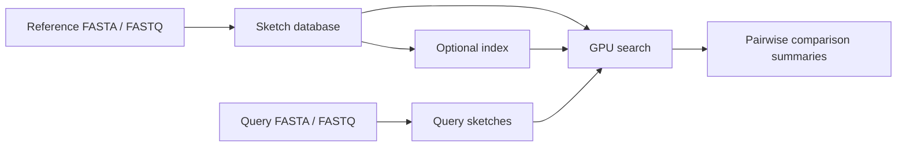

# cuDDL

[](https://tdortman.github.io/cuDDL/)

cuDDL is a C++20/CUDA library for estimating genome relationships from canonical k-mers. It builds compact sketches from FASTA and FASTQ files, compares sketches on the GPU, and searches reusable reference databases with optional dense or sparse indexes.

Use it to estimate cardinality, containment, weighted k-mer identity, and k-mer-derived ANI without retaining every distinct k-mer. These are sketch estimates, not sequence alignments.

## How it works



Each input file represents one genome, including all of its sequence records. Reference sketches can be saved once and reused across searches. The C++ API also accepts device-resident packed k-mers and raw nucleotide sequences.

## Quick start

### Requirements

- Linux and an NVIDIA GPU with a compatible driver.
- CUDA 13.0 or newer and a host compiler with C++20 support. The supplied Nix environment uses CUDA 13.4.
- Optional nvCOMP 5, used to inflate gzip genomes on the GPU.
- Meson 1.3 or newer, Ninja, and Git.

The default build targets `sm_80`, `sm_90`, and `sm_120`. Your toolkit must recognize all three targets. For a different GPU target, adjust `cuda_arch_args` in [meson.build](meson.build) before configuring.

Meson enables nvCOMP when it finds the library and headers. Pass `-Dnvcomp=enabled` to require them or `-Dnvcomp=disabled` to build without nvCOMP entirely.

Meson fetches the pinned dependencies, including CCCL, libdeflate, and CLI11. Use the supplied CCCL revision: cuDDL requires its CUB 3.6.0 headers rather than an arbitrary toolkit-bundled version. The initial setup needs network access.

### Build

```sh
git clone https://github.com/tdortman/cuDDL.git
cd cuDDL

# Optional: enter the supplied development environment.
nix develop

meson setup build
meson compile -C build
```

Without Nix, install the requirements above and omit `nix develop`. The flake provides development shells for `x86_64-linux` and `aarch64-linux`.

For an existing build directory, use `meson configure build` with the same `-D` options instead of `meson setup`.

The command-line tools support one sketch configuration per build: k = 25, 2,048 buckets and a 5-bit exponent with an 11-bit mantissa by default. For other settings, pass `-Dcli_kmer_length` (1 to 31), `-Dcli_buckets` (2048, 4096 or 8192) and `-Dcli_exponent_bits` (5 or 6) and rebuild. A 6-bit exponent handles unbounded cardinality, such as metagenomes. A 5-bit exponent halves false register matches for genome-to-genome comparison. The search tool rejects databases built with a different configuration.

### Run a GPU smoke check

```sh
./build/examples/cuddl-main --count 4096
```

This uses synthetic packed k-mers and prints cardinality and pairwise metrics.

## Reference search

The following commands assume reference genomes are under `genomes/references/` and query genomes under `genomes/queries/`. Substitute your own paths. Database and index output paths replace existing files.

### 1. Build a reference database

```sh
./build/examples/cuddl-build-reference-db \
  --output references.cuddl \
  genomes/references/
```

The builder searches the folder recursively and sorts file paths to assign reference IDs. Keep that ordered input list if you need to map result IDs back to filenames.

Pass `--blacklist blacklist.fa.gz` to exclude literal k-mers during construction. BBTools DDL FASTA blacklists work directly, including fused records; one exact DNA k-mer per text line is also accepted. The database embeds the normalized list, and raw queries automatically use it. Keep k consistent with the blacklist. Changing the list requires rebuilding the database and its index. See [blacklist construction](docs/reference-database.md#blacklist-construction).

The builder reads FASTA and FASTQ files with the extensions `.fa`, `.fna`, `.fasta`, `.ffn`, `.frn`, `.fq`, and `.fastq`, in any letter case. Gzip and BGZF files add `.gz`, `.bgz`, or `.bgzf`, as in `genome.fna.gz`.

By default, a discrete GPU inflates gzip and BGZF FASTA files with nvCOMP, or with the hardware decompression engine on Blackwell data-center GPUs, and checks each file's length and CRC32 against its gzip trailers. Coherent-memory GPUs such as GH200 inflate on CPU workers instead. Everything else goes to the host loader: FASTQ, multi-member gzip that is not BGZF, and any file the GPU cannot verify.

The host loader checks the gzip structure and the uncompressed length, but not the CRC32. If you need that guarantee, verify the input files before you build. Saved databases and indexes carry their own checksum, which cuDDL checks on every load.

[Build and save a reference database](docs/reference-database.md#choose-a-decompression-backend) covers the decompression backends and how each one loads files.

| Option            | Accepted values                                                                                                                                               |
| ----------------- | ------------------------------------------------------------------------------------------------------------------------------------------------------------- |
| `--workers`       | Concurrent genome loaders, defaults to the number of logical cores. Use 1 to reduce host RAM usage.                                                           |
| `--decompression` | `automatic` (default), `cpu`, `gpu`, or `hybrid`. `cpu` inflates and parses every input with the host loaders, `gpu` sends eligible gzip inputs to nvCOMP and copies plain FASTA to the GPU unchanged, and `hybrid` inflates on the host loaders and strips FASTA headers and line breaks on the GPU. `gpu` and `hybrid` need nvCOMP. On discrete GPUs, `automatic` picks `cpu` with 48 or more loaders and `gpu` with fewer; with few cores per GPU, `hybrid` can be faster. |

### 2. Search without an index

```sh
./build/examples/cuddl-reference-index search references.cuddl \
  --query genomes/queries/query-a.fna genomes/queries/query-b.fna \
  --minimum-matches 0 \
  > matches.tsv
```

`--minimum-matches 0` compares each query against every reference. Queries are sketched with the configuration compiled into the tool, which must match the database. `--decompression automatic|cpu|gpu|hybrid` selects how query genomes are inflated, with the same values as the builder.

### 3. Optionally build and use an index

```sh
./build/examples/cuddl-reference-index build references.cuddl \
  --output references.cuddl.index

./build/examples/cuddl-reference-index search references.cuddl \
  --index references.cuddl.index \
  --query genomes/queries/query-a.fna genomes/queries/query-b.fna \
  --minimum-matches 1 \
  > candidates.tsv
```

`--format automatic|dense|sparse` selects the index storage. The default, `automatic`, builds whichever needs less device memory: sparse up to about 1.75 references per index key (57,342 references with 15-bit keys, 114,686 with 16-bit keys), dense above that. Dense offsets favor query latency, so pass `--format dense` to keep them for smaller databases. Search detects the saved format and validates the index against the database. Rebuild the index when you rebuild the database.

`--minimum-matches` counts matching indexed buckets, not matching k-mers or a percentage identity. A positive threshold filters candidates and is not an exhaustive comparison. Omit `--index` to search directly against the database.

To compare the references with each other instead of with separate queries, replace `--query` with `--all-to-all`. Each unordered pair is searched once and reported with `query_id < reference_id`; both IDs are reference IDs. `--devices 0 1 2` splits an all-to-all search across the listed GPU ordinals. Each GPU holds its own copy of the database (and of the index, if one is given) and claims work as it finishes, so mixed GPUs share the load. The output is identical for any device list, because results are still written in query order. Long query lists can go in a TOML file passed as `--config options.toml` before `search`, with `query = [...]` under a `[search]` section.

### Reading the output

Search writes a tab-separated table to standard output:

```text
query_id    reference_id    lower    equal    higher    both_empty
```

The actual delimiter is a tab. Query IDs are zero-based in the order supplied to `--query`; reference IDs are zero-based in the builder's sorted file order. The remaining columns contain raw sketch comparison counts. This CLI does not output ranked hits or ANI scores. Use the C++ metric helpers when you need derived metrics.

For large result sets, pass `--output results.bin` to skip text formatting. The file holds headerless 24-byte little-endian records with the same six `uint32` fields in the same order. Python reads it with `struct.iter_unpack("<6I", data)`; NumPy reads it with a structured dtype of six `<u4` fields. Records are expanded from the GPU's packed results on every core, and an `--all-to-all` search writes each tile while the GPUs search the next. On one GH200, all 5×10⁹ pairs of 100,000 genomes (120 GB of records) reach the writer in 1.2 s.

## C++ API

Include `<cuddl/cuddl.cuh>` for the main API. File-based reference database I/O is available through `<cuddl/reference_database_file.cuh>`.

| Type                                                             | Purpose                                                                        |
| ---------------------------------------------------------------- | ------------------------------------------------------------------------------ |
| `cuddl::sketch<K, BucketCount>`                                  | Own a GPU sketch, add k-mers or sequence data, and calculate pairwise metrics. |
| `cuddl::query_sketch_batch<K, BucketCount>`                      | Sketch a batch of genome files for queries.                                    |
| `cuddl::reference_database<K, BucketCount>`                      | Store reference sketches and search them on the GPU.                           |
| `cuddl::reference_index<K, BucketCount>`                         | Build optional dense or sparse search acceleration data.                       |
| `cuddl::replicated_database<K, BucketCount>`                     | Search all-to-all on several GPUs, one database replica per device.            |
| `cuddl::reference_database_file` / `cuddl::reference_index_file` | Save and load databases and indexes.                                           |
| `cuddl::slice_genomes` / `cuddl::gather_sketches`                | Sketch one genome collection across MPI ranks (`<cuddl/distributed.cuh>`).     |

Start with the runnable [sketch example](examples/main.cu), [database builder](examples/build_reference_database.cu), or [search implementation](examples/reference_index.cu).

For GPU-only pipelines, `cuddl::build_sketch_store<K, BucketCount>` loads genome files into a device-resident store without downloading the registers. Each row contains `BucketCount` registers, one winning score per bucket. The batch operations in `<cuddl/batch.cuh>` consume this layout directly. Use `query_sketch_batch` when you only need query scores.

The API uses CUDA streams. Keep the allocation stream alive longer than its sketches and keep asynchronous inputs alive and unchanged until the stream completes. `add_sequence_async` expects contiguous device-resident ASCII bases, not a FASTA file; use the file-loading APIs for FASTA and FASTQ input. Operations returning `cuddl::Result` require error handling; the examples use `CUDDL_UNWRAP`.

Batch refinement on Hopper can stage up to 128 KiB of query rows per block to reuse each reference across more queries. Other architectures retain the 96 KiB staging limit. Rows that do not fit continue through the global-memory path.

Refinement compares all 16 score bits, independently of the index key mask. It skips empty-bucket counting only after verifying that every reference score is nonzero; sparse rows retain the full calculation.

Pairwise helpers include `wkid`, `ani`, `containment`, and `completeness`. ANI here is the k-th root of estimated weighted k-mer identity, not alignment-derived identity.

Indexed counting walks short posting lists per lane and medium lists per warp. Only lists with enough postings to occupy every block thread enter the block-wide queue.

Large dense and sparse indexes also cache lists whose reference bitmaps are no larger than their posting arrays. Batch search first counts bitmap matches with saturating bit-sliced counters, then adds the remaining posting-list matches. The cache is rebuilt on load; the index file format is unchanged.

Posting lists and cached bitmaps request CUDA transparent memory compression on supported Hopper and newer GPUs; other devices use ordinary device allocations. Compression affects device storage, not the on-disk representation.

The root Meson project exposes `cuddl_dep` for subproject integration. Examples, tests, and benchmarks default to enabled in a standalone build and disabled when cuDDL is a subproject.

## Tests

Enable the test targets in your existing build:

```sh
meson configure build -Dtests=enabled
meson compile -C build
meson test -C build --print-errorlogs
```

GPU tests require a working CUDA device. The suite covers sketch operations and persistent reference index files, alongside result serialization checks.

## Benchmarks

Benchmarks are separate from the quick-start build because they pull in NVBench and additional comparison tools.

```sh
meson configure build -Dbenchmarks=enabled
meson compile -C build
uv run scripts/run_micro_comparison.py --help
```

The [micro-comparison runner](scripts/run_micro_comparison.py) measures sketch construction, pairwise comparison, and search. It records native tool settings and separates resident processing from end-to-end timings where the tools can isolate it. Dashing2 stages FASTX reads before sketching, so its sketch, compare, and search operations all report resident timings. The [pairwise accuracy runner](scripts/run_pairwise_accuracy.py) evaluates comparison quality; [plot_micro_comparison.py](scripts/plot_micro_comparison.py) plots micro-benchmark results.

Every tool in the micro comparison evaluates the same pair set; all-to-all compares each unordered pair once. Each CPU tool runs at every `--threads` count, which defaults to half the physical cores, all of them, and all logical CPUs, and reports its fastest count in `case.threads`. CPU lanes bind OpenMP threads to cores and stay on one NUMA node when their threads fit its physical cores. Every wall is a whole process, timed from spawn to exit with one operation per process, so start-up and teardown count for every tool alike. `case.timing_scope` is `process`, or `process_jvm` for BBTools, whose wall includes JVM start-up; the plots label the latter. `--ani-truth` scores ANI against ANIm, built from MUMmer 4 `nucmer` alignments that `delta-filter -1` reduces to 1-to-1 matches, on a sample of the exact oracle's pairs at or above 80 percent exact Mash ANI.

pp-sketchlib runs through a small harness of its own classes, `build/benchmarks/ppsketchlib-micro`. Meson builds pp-sketchlib and the HDF5 library its databases need from source, so no system HDF5 is required. It sketches assemblies on the CPU at k = 15, 19, 23, 27 and 31 and fits core and accessory distances on the GPU. Its comparison rows report the Jaccard index at k = 25 that the fit predicts. The build patches three things in its GPU kernel. Pairs with too few k-mer lengths left to fit get distance 1, as its CPU path reports them, instead of 0, which would read as identical genomes. Each block initialises its barrier once instead of once per k-mer length, which raced with warps still waiting on the previous length and hung large comparisons. The distance index is 64-bit, because all pairs of 100,000 genomes overflow a 32-bit one.

`--reference-count N` keeps the N genomes whose hashed file names come first. Accession order clusters species, so the first N accessions are far more or less redundant than the corpus. The hashed sample keeps the corpus's mix and picks the same genomes on every host.

Use the supplied development shell for the benchmark toolchain. RabbitSketch and Dashing2 builds are x86-only and are skipped on ARM hosts. Compare runs with their dataset, hardware, sketch settings, and timing scope attached, rather than treating one speedup as universal.

## License

cuDDL is distributed under the [Boost Software License 1.0](LICENSE). Third-party dependencies retain their own licenses.
