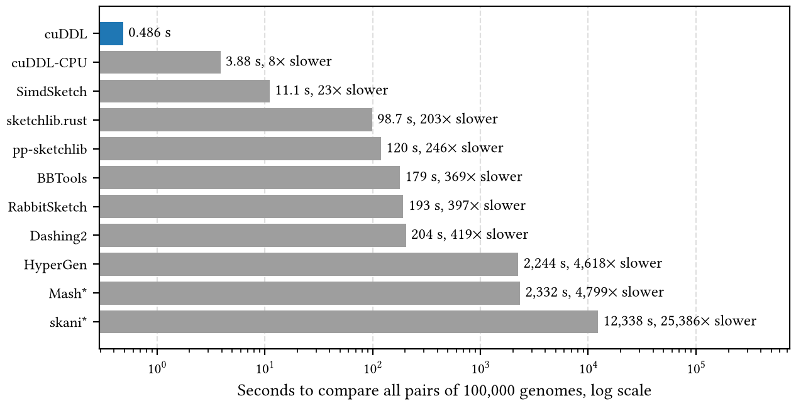
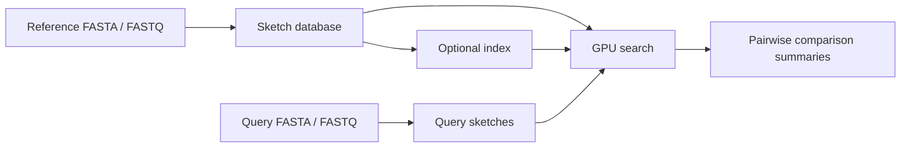

# cuDDL

[](https://tdortman.github.io/cuDDL/)

cuDDL is a C++20 and CUDA library for estimating genome relationships from canonical k-mers. It builds compact sketches from FASTA and FASTQ files, compares sketches on the GPU, and searches reusable reference databases with optional dense or sparse indexes.

Use it to estimate cardinality, containment, weighted k-mer identity, and k-mer-derived ANI without keeping every distinct k-mer. These are sketch estimates, not sequence alignments.

## All-to-all comparison in under a second



On a workstation with a 60-core Xeon w9-3595X and an RTX 5090, cuDDL compares all 5 billion pairs of 100,000 RefSeq bacterial genomes in 0.46 s. SimdSketch, the fastest of the other tools, takes 16.7 s on all 120 threads. The whole run, from FASTA files to 20 GB of similarity scores written to a file, takes cuDDL 10.3 s and SimdSketch 58.4 s.

Each bar times the comparison of sketches that are already in memory. Every CPU tool ran with 120 threads, including HyperGen, whose CPU mode beat its GPU mode. pp-sketchlib ran its GPU distance kernel on the same RTX 5090. Tools marked \* ran on 10,000 genomes and are extrapolated from that.

## How it works



Each input file is one genome. cuDDL sketches all of its sequence records together. You can save reference sketches once and reuse them across searches. The C++ API also accepts device-resident packed k-mers and raw nucleotide sequences.

## Quick start

### Requirements

- Linux and an NVIDIA GPU with a compatible driver.
- CUDA 13.0 or newer and a host compiler with C++20 support. The supplied Nix environment uses CUDA 13.4.
- Optional nvCOMP 5, which inflates gzip genomes on the GPU.
- Meson 1.3 or newer, Ninja, and Git.

The default build targets `sm_80`, `sm_90`, and `sm_120`. Your toolkit must recognize all three targets. For a different GPU target, adjust `cuda_arch_args` in [meson.build](meson.build) before you configure.

Meson enables nvCOMP when it finds the library and headers. Pass `-Dnvcomp=enabled` to require them, or `-Dnvcomp=disabled` to build without nvCOMP.

Meson fetches the pinned dependencies, including CCCL, libdeflate, and CLI11, so the first setup needs network access. Use the pinned CCCL revision. cuDDL needs its CUB 3.6.0 headers, and the CUB bundled with your toolkit may be a different version.

### Build

```sh
git clone https://github.com/tdortman/cuDDL.git
cd cuDDL

# Optional: enter the supplied development environment.
nix develop

meson setup build
meson compile -C build
```

Without Nix, install the requirements above and leave out `nix develop`. The flake provides development shells for `x86_64-linux` and `aarch64-linux`.

To change options in an existing build directory, run `meson configure build` with the same `-D` options instead of `meson setup`.

Each build of the command-line tools supports one sketch configuration. The default is k = 25, 2,048 buckets, and a 5-bit exponent with an 11-bit mantissa. For other settings, pass `-Dcli_kmer_length` (1 to 31), `-Dcli_buckets` (2048, 4096, or 8192), and `-Dcli_exponent_bits` (5 or 6), then rebuild. A 6-bit exponent handles unbounded cardinality, such as metagenomes. A 5-bit exponent halves false register matches for genome-to-genome comparison. The search tool rejects databases built with a different configuration.

### Run a GPU smoke check

```sh
./build/examples/cuddl-main --count 4096
```

The example sketches synthetic packed k-mers and prints cardinality and pairwise metrics.

## Reference search

The commands below read reference genomes from `genomes/references/` and query genomes from `genomes/queries/`. Substitute your own paths. Writing a database or an index overwrites any existing file at the output path.

### 1. Build a reference database

```sh
./build/examples/cuddl-build-reference-db \
  --output references.cuddl \
  genomes/references/
```

The builder searches the folder recursively and sorts the file paths to assign reference IDs. Keep that sorted list if you need to map result IDs back to file names.

To exclude literal k-mers from the database, pass `--blacklist blacklist.fa.gz`. BBTools DDL FASTA blacklists work as they are, including fused records. A text file with one exact DNA k-mer per line also works. The database embeds the normalized list, and searches apply it to raw queries. The blacklist k-mers must have the same length k as the database. To change the list, rebuild the database and its index. See [blacklist construction](docs/reference-database.md#blacklist-construction).

The builder reads FASTA and FASTQ files with the extensions `.fa`, `.fna`, `.fasta`, `.ffn`, `.frn`, `.fq`, and `.fastq`, in any letter case. Gzip and BGZF files add `.gz`, `.bgz`, or `.bgzf`, as in `genome.fna.gz`.

By default, a discrete GPU inflates gzip and BGZF FASTA files with nvCOMP. Blackwell data-center GPUs use their hardware decompression engine instead. The GPU checks each file's length and CRC32 against its gzip trailer. On coherent-memory GPUs such as GH200, CPU workers inflate the files. The host loader handles everything else: FASTQ, multi-member gzip that is not BGZF, and any file the GPU cannot verify.

The host loader checks the gzip structure and the uncompressed length, but not the CRC32. If you need that guarantee, verify the input files before you build. cuDDL checks the checksum of saved databases and indexes on every load.

[Build and save a reference database](docs/reference-database.md#choose-a-decompression-backend) covers the decompression backends and how each one loads files.

| Option            | Description                                                                                                                                                                                                                                                                                                                                                                                                                  |
| ----------------- | ---------------------------------------------------------------------------------------------------------------------------------------------------------------------------------------------------------------------------------------------------------------------------------------------------------------------------------------------------------------------------------------------------------------------------- |
| `--workers`       | Number of genomes loaded at once. Defaults to the number of logical cores. Use 1 to reduce host RAM use.                                                                                                                                                                                                                                                                                                                     |
| `--decompression` | `automatic` (default), `cpu`, `gpu`, or `hybrid`. `cpu` inflates and parses every input on the host loaders. `gpu` sends eligible gzip inputs to nvCOMP and copies plain FASTA to the GPU unchanged. `hybrid` inflates on the host loaders and strips FASTA headers and line breaks on the GPU. `gpu` and `hybrid` need nvCOMP. `automatic` picks `gpu` on discrete GPUs and `hybrid` on coherent-memory GPUs such as GH200. |
| `--direct-reads`  | Read genomes with `O_DIRECT`, without the page cache. On Lustre, this cut a cold 100,000-genome build from 36.3–40.4 s to 33.4–36.2 s. Nothing stays cached, so a second run reads from storage again. See [input and reference IDs](docs/reference-database.md#input-and-reference-ids).                                                                                                                                    |

### 2. Search without an index

```sh
./build/examples/cuddl-reference-index search references.cuddl \
  --query genomes/queries/query-a.fna genomes/queries/query-b.fna \
  --minimum-matches 0 \
  > matches.tsv
```

`--minimum-matches 0` compares each query against every reference. The tool sketches queries with the configuration compiled into it, which must match the database. `--decompression` takes the same values as the builder and selects how the tool inflates query genomes.

For long query lists, put `query = [...]` under a `[search]` section of a TOML file and pass the file as `--config options.toml` before `search`.

### 3. Search with an index

An index is optional. It lets a search skip references that share too few buckets with the query.

```sh
./build/examples/cuddl-reference-index build references.cuddl \
  --output references.cuddl.index

./build/examples/cuddl-reference-index search references.cuddl \
  --index references.cuddl.index \
  --query genomes/queries/query-a.fna genomes/queries/query-b.fna \
  --minimum-matches 1 \
  > candidates.tsv
```

`--format automatic|dense|sparse` selects the index storage. The default, `automatic`, builds whichever format needs less device memory. That is sparse up to about 1.75 references per index key, which is 57,342 references with 15-bit keys or 114,686 with 16-bit keys, and dense above that. Dense indexes answer queries faster, so pass `--format dense` to use them for smaller databases too. Search detects the saved format and validates the index against the database. Rebuild the index when you rebuild the database.

`--minimum-matches` counts matching indexed buckets, not matching k-mers or percent identity. A positive threshold filters candidates, so the search is no longer exhaustive. To search the database directly, leave out `--index`.

### Compare the references with each other

To compare the references with each other instead of with separate queries, replace `--query` with `--all-to-all`:

```sh
./build/examples/cuddl-reference-index search references.cuddl \
  --all-to-all \
  --minimum-matches 0 \
  --devices 0 1 \
  --output all-pairs.bin
```

The search compares each unordered pair once and reports it with `query_id < reference_id`. Both IDs are reference IDs.

`--devices` splits an all-to-all search across the listed GPU ordinals. Each GPU holds its own copy of the database, and of the index if you pass one. GPUs claim work as they finish, so mixed GPUs share the load. The tool writes results in query order, so the output is identical for any device list.

### Read the output

Search writes a tab-separated table to standard output:

```text
query_id    reference_id    lower    equal    higher    both_empty
```

Query IDs are zero-based positions in the `--query` list. Reference IDs are zero-based positions in the builder's sorted file list. The other columns are raw sketch comparison counts. The CLI does not rank hits or print ANI. For derived metrics, use the C++ metric helpers.

For large result sets, pass `--output results.bin` to skip text formatting. The file holds headerless, 24-byte, little-endian records with the same six `uint32` fields in the same order. Python reads it with `struct.iter_unpack("<6I", data)`. NumPy reads it with a structured dtype of six `<u4` fields.

`--records similarity` writes each pair's weighted k-mer identity as a 4-byte float instead, in the `cuddl::result_format::similarity` layout. An exhaustive search, which is `--minimum-matches 0` without an index, writes each tile as its first query ID and its query count, both `uint32`, followed by one float per pair. Other searches write 12-byte records of query ID, reference ID, and similarity.

The CLI writes through `cuddl::result_file`. It expands the GPU's packed results into records on every core and writes each tile while the GPU searches the next one. On one GH200, all 5×10⁹ pairs of 100,000 genomes, 120 GB of records, reach the writer in 1.2 s.

The writer expands records straight into its buffers and writes them with `O_DIRECT`, unless the page cache takes them faster than the drive. It times both methods on the first 64 MiB and keeps the faster one. Writing every pair of 50,000 genomes (30 GB) to a Samsung 9100 PRO took 3.0 s, against 10.0–10.2 s through the page cache, which could not keep up with the drive. On a Samsung PM9A3 the same write took 4.8–5.0 s, against 4.5 s through the page cache, because the page cache accepted the records and wrote them to the drive after the search exited.

On btrfs, the writer turns off compression for the result file. Direct writes are never compressed, and compressing during writeback slowed the page cache. On a WD SN850X mounted with `compress=zstd:3`, writing every pair of 100,000 genomes (120 GB) took 43.4–44.5 s instead of 55.9–58.9 s.

## C++ API

Include `<cuddl/cuddl.cuh>` for the main API. `<cuddl/reference_database_file.cuh>` saves and loads reference databases.

| Type                                                             | Purpose                                                                        |
| ---------------------------------------------------------------- | ------------------------------------------------------------------------------ |
| `cuddl::sketch<K, BucketCount>`                                  | Own a GPU sketch, add k-mers or sequence data, and calculate pairwise metrics. |
| `cuddl::query_sketch_batch<K, BucketCount>`                      | Sketch a batch of genome files for queries.                                    |
| `cuddl::reference_database<K, BucketCount>`                      | Store reference sketches and search them on the GPU.                           |
| `cuddl::reference_index<K, BucketCount>`                         | Build an optional dense or sparse index that speeds up search.                 |
| `cuddl::replicated_database<K, BucketCount>`                     | Search all-to-all on several GPUs, one database replica per device.            |
| `cuddl::reference_database_file` / `cuddl::reference_index_file` | Save and load databases and indexes.                                           |
| `cuddl::result_file`                                             | Write any search's tiles to files while it runs, as counts or similarities.    |
| `cuddl::slice_genomes` / `cuddl::gather_sketches`                | Sketch one genome collection across MPI ranks (`<cuddl/distributed.cuh>`).     |

Start with the runnable [sketch example](examples/main.cu), [database builder](examples/build_reference_database.cu), or [search implementation](examples/reference_index.cu).

For GPU-only pipelines, `cuddl::build_sketch_store<K, BucketCount>` loads genome files into a device-resident store without copying the registers to the host. Each row holds `BucketCount` registers, one winning score per bucket. The batch operations in `<cuddl/batch.cuh>` read this layout directly. Use `query_sketch_batch` when you need only query scores.

The API uses CUDA streams. Keep the allocation stream alive longer than its sketches. Keep asynchronous inputs alive and unchanged until the stream completes. `add_sequence_async` expects contiguous, device-resident ASCII bases, not a FASTA file. For FASTA and FASTQ input, use the file-loading APIs. Operations that return `cuddl::Result` require error handling. The examples use `CUDDL_UNWRAP`.

Pairwise helpers include `wkid`, `ani`, `containment`, and `completeness`. ANI here is the k-th root of the estimated weighted k-mer identity, not an alignment-derived identity.

[How search uses the GPU](docs/reference-database.md#how-search-uses-the-gpu) describes the search kernels, the index caches, and their device memory.

The root Meson project exposes `cuddl_dep` for subproject integration. Examples, tests, and benchmarks are enabled by default in a standalone build and disabled when cuDDL is a subproject.

## Tests

Enable the test targets in your existing build:

```sh
meson configure build -Dtests=enabled
meson compile -C build
meson test -C build --print-errorlogs
```

The GPU tests need a working CUDA device. The suite covers sketch operations, saved reference indexes, and result serialization.

## License

cuDDL is distributed under the [Boost Software License 1.0](LICENSE). Third-party dependencies keep their own licenses.
